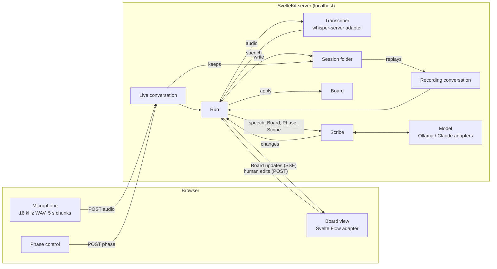

# Architecture

How the "can it work" stage in [PLAN.md](../PLAN.md) is built. Domain terms are in [GLOSSARY.md](../GLOSSARY.md). Design terms (module, interface, seam, adapter, deep) follow the `codebase-design` skill: a **seam** exists only where something varies, and each module is tested through its interface.

## The shape in one picture

One SvelteKit app on localhost. The **server holds the Board**; the browser captures the microphone and shows the Board. Everything the Scribe does happens in a **Run**, and a Run never knows whether its conversation is live or coming from a Recording.



A headless CLI starts the same Run from a Recording with no browser, which is how most testing happens: `npm run scribe -- <session> [--audio] [--realtime] [--model ollama:qwen3:8b]`, then `npm run score -- <session> <run>`.

## Modules

| Module | Deep because | Seam? |
|---|---|---|
| **Board** | All the domain rules (ownership, Mentions, merges, removal, timeline order, Pivotal marks, Hot Spot attachment) behind one `apply` | No: pure, tested directly |
| **Scribe** | Prompting, per-Phase change vocabulary, schema, validation and repair behind one `hear` | No, but it has the Model seam inside |
| **Model** | — | **Yes**: Ollama and Claude adapters (two adapters, a real seam) |
| **Transcriber** | — | **Yes**: whisper-server adapter, plus a fixture adapter in tests |
| **Conversation source** | Turns live input or a Recording into one ordered event stream | **Yes**: live and Recording adapters (two adapters) |
| **Run** | Wires the rest together: transcribing, batching speech for the Scribe, applying changes, saving, broadcasting | No: tested with fakes at the seams |
| **Views** | Where every Sticky goes in each Phase view | No: pure layout functions |
| **Board view** | — | **Yes**, by Dom's choice: Svelte Flow is the only adapter for now, kept thin so it can be replaced |
| **Session folder** | Reading and writing `~/EventStorm/<session>/` | No: one adapter, tested against a temp folder |
| **Scoring** | Comparing a Run's Board with the Expected List | No: pure, with a pluggable matcher |

### Board

A pure module: no I/O, no time, no randomness passed in from outside.

```ts
type StickyKind = 'domain-event' | 'hot-spot';

interface Sticky {
  id: string;            // short and stable, e.g. "s7", so the Scribe can refer to it
  kind: StickyKind;
  text: string;
  pivotal: boolean;      // only meaningful for a Domain Event
  concerns?: string;     // a Hot Spot's Sticky
  mentions: number;
  saidAt: number;        // seconds into the Session
  owner: 'scribe' | 'human';
  removed: boolean;      // kept, so the Scribe can't bring it back
}

interface Board {
  scope: string;
  goal: string;
  stickies: Sticky[];
  timeline: string[];    // Domain Event ids in domain order
}

function apply(board: Board, change: BoardChange): { board: Board; applied: boolean };
```

`BoardChange` is either a **Scribe change** or a **human edit**, each tagged with its author. The rules live here and nowhere else:

- A Scribe change to a human-owned or removed Sticky is not applied (`applied: false`, logged), except adding a Mention, since counting isn't editing.
- Any human edit makes the Sticky the human's.
- The Scribe merges only Stickies it owns. Merging keeps the earliest Sticky, adds up the Mentions and removes the rest.
- Removing a Sticky keeps it with `removed: true`, so a later Mention of the same thing doesn't recreate it.

Pivotal Event is a mark on a Domain Event, not its own kind, so that marking and unmarking one doesn't change its identity.

### Scribe and the Model seam

```ts
interface Model {
  complete<T>(request: { system: string; prompt: string; schema: JSONSchema }): Promise<T>;
}

function createScribe(model: Model): {
  hear(context: { phase: Phase; scope: string; board: Board; speech: Speech[] }): Promise<ScribeChange[]>;
};
```

The Scribe builds the prompt (the Scope, the current Board with Sticky ids, and the new speech), asks the Model for changes using the **schema for the current Phase**, and drops any change that fails validation instead of failing the Run. Each Phase allows a different set of changes, which keeps the schema small for an 8B model and keeps the Scribe true to the method:

| Phase | Changes the Scribe may make |
|---|---|
| Kick Off | set Scope, set Goal |
| Chaotic Exploration | add Domain Event or Hot Spot, add Mention, rename, remove |
| Enforce the Timeline | all of the above, plus merge, set timeline order, mark or unmark Pivotal, attach Hot Spot |

Model adapters:

- **Ollama** (`qwen3:8b`): `format` set to the schema, thinking turned off for speed, `keep_alive` long so the model stays loaded.
- **Claude**: used only for comparison Runs; structured output with the same schema. Needs an API key in a local `.env`, never committed.

### Transcriber seam

```ts
interface Transcriber {
  transcribe(audio: { wav: Uint8Array; at: number }): Promise<Speech[]>;   // Speech = { at: number; text: string }
}
```

The **whisper-server** adapter posts each chunk to `whisper-server` on localhost (model `small.en`). The browser encodes the WAV itself (16 kHz mono, through an AudioWorklet), so no ffmpeg is needed. Tests use a fixture adapter that returns canned text.

### Conversation source seam

```ts
type ConversationEvent =
  | { type: 'audio'; at: number; wav: Uint8Array }
  | { type: 'speech'; at: number; text: string }
  | { type: 'phase'; at: number; phase: Phase }
  | { type: 'end'; at: number };

interface ConversationSource {
  events(): AsyncIterable<ConversationEvent>;
}
```

- **Live** receives audio chunks and Phase clicks from the browser, keeps them as the Recording as they arrive, and passes them on.
- **Recording** replays a Session's Recording. By default it replays the **stored transcript** as `speech` events, so a Run tests only the Scribe and runs as fast as the Model allows. With `--audio` it replays the audio, so the Transcriber is tested too. With `--realtime` it keeps the original timing, for demos.

### Run

```ts
function startRun(deps: {
  source: ConversationSource;
  transcriber: Transcriber;
  scribe: Scribe;
  folder: SessionFolder;
}): {
  board(): Board;
  subscribe(listener: (update: BoardUpdate) => void): () => void;
  edit(edit: HumanEdit): void;
  done: Promise<Board>;
};
```

The Run turns audio into speech, keeps the current Phase, and calls the Scribe with new speech. **Only one Scribe call is in flight at a time:** speech that arrives meanwhile is batched into the next call, so a slow Model makes Stickies appear later but never builds a backlog. Every applied change is appended to the Run's change log, and the Board file is rewritten after each batch.

Latency budget for a Sticky: 5 s chunk + about 1–2 s whisper + about 3–8 s Model ≈ 9–15 s, at the edge of the 5–15 s target. The Model call is the part to watch, and the comparison seam is how we'd find out whether a faster or better Model helps.

### Views and the Board view seam

```ts
type View = 'kick-off' | 'chaotic-exploration' | 'enforce-the-timeline';

function layout(board: Board, view: View): Placed[];   // Placed = { sticky | panel, x, y, width, height }
```

Layout is pure and lives with us, not Svelte Flow: the Chaotic Exploration view is a grid in spoken order, the Enforce the Timeline view runs left to right in `timeline` order with Pivotal Events as dividers and Hot Spots beside the Sticky they concern, and the Kick Off view is the two panels.

The **Board view** is one Svelte component, `<BoardView placed highlight onedit />`. Its only adapter, `SvelteFlowBoardView.svelte`, is the only file that imports `@xyflow/svelte`. Pan, zoom, selection and drag come from Svelte Flow. A dragged Sticky becomes a human edit carrying its new position, which the layout then keeps.

### Session folder

```text
~/EventStorm/
└── 2026-11-12-ordering-a-takeaway/
    ├── session.json         # title, created, Phase marks (Phase + seconds)
    ├── recording/           # 0001.wav, 0002.wav, … (5 s chunks)
    ├── transcript.jsonl     # one Speech per line
    ├── expected.txt         # the Expected List, one Domain Event per line, in order
    └── runs/
        └── 2026-11-12T10-04-ollama-qwen3-8b/
            ├── board.json   # the Board, stable order, one field per line
            ├── changes.jsonl  # every change, applied or not, with its author and time
            └── score.json   # written by `npm run score`
```

The root defaults to `~/EventStorm` and is set with `EVENTSTORM_HOME`.

### Scoring

```ts
function score(board: Board, expected: string[], match: Matcher): {
  caught: string[]; missed: string[]; junk: string[]; orderAgreement: number;
};
```

The default matcher is text similarity on normalised Domain Event names. `orderAgreement` compares the caught Domain Events' timeline order with the Expected List's (1 means identical order). A Model-based matcher can be added later behind `Matcher`.

## Code layout

```text
src/
├── lib/
│   ├── board/           # Board: Stickies and the rules
│   ├── scribe/          # Scribe, per-Phase schemas
│   │   └── models/      # Model adapters: ollama.ts, claude.ts
│   ├── transcriber/     # Transcriber adapters: whisper-server.ts
│   ├── conversation/    # Conversation sources: live.ts, recording.ts
│   ├── run/             # Run
│   ├── views/           # layout per view
│   ├── board-view/      # BoardView, SvelteFlowBoardView.svelte
│   ├── session-folder/  # ~/EventStorm reading and writing
│   └── scoring/
├── routes/              # pages, audio and edit endpoints, Board updates over SSE
└── cli/                 # scribe.ts, score.ts (headless Runs)
```

## Local services

- `brew install whisper-cpp`, then `whisper-server` with `ggml-small.en.bin` on its default localhost port.
- `ollama pull qwen3:8b`. Memory: about 1 GB for whisper `small.en` and about 5–6 GB for `qwen3:8b`, which leaves room for the browser on 16 GB.

## Slices

Each slice is one issue, one branch and one PR (ADR 0001), and each ends with something Dom can try. They run in order; the CLI and scoring come early so every later slice can be measured.

| # | Slice | Try it |
|---|---|---|
| 0 | **Add the JS/TS (Svelte) stack** (#4) | `npm test` and CI green |
| 1 | **Talk and see the transcript:** start a Session, microphone to WAV chunks, Live conversation, whisper-server Transcriber, transcript streamed to the page, Recording and transcript kept in the Session folder | Talk; your words appear; the folder holds the Recording |
| 2 | **Domain Events appear:** Board (add, Mention), Scribe with the Ollama Model for Chaotic Exploration, Run, Chaotic Exploration view, Board view with Svelte Flow | Talk through ordering a takeaway; Domain Events appear within about 15 s |
| 3 | **Re-run and score:** Recording conversation (transcript, fast), `npm run scribe` and `npm run score`, Expected List | Write `expected.txt`, re-run, get caught / missed / junk |
| 4 | **Kick Off and Phases:** Phase control, Phase marks in the Recording and replayed in Runs, Scope and Goal changes, Kick Off view, switching views at any time | Set the Scope aloud; it shows in the Kick Off panel; Phase switches survive a re-run |
| 5 | **Hot Spots and the Scribe changing its mind:** Hot Spot kind, rename and remove by the Scribe | Raise a question and later reverse a statement; the Board follows |
| 6 | **Human edits:** edit text or kind, delete, drag, add; ownership | Edit a Sticky, keep talking about it; the Scribe leaves it alone |
| 7 | **Enforce the Timeline:** merge, timeline order, Pivotal marks, Hot Spot attachment, the timeline view | Narrate the order; the timeline forms with Pivotal dividers; `orderAgreement` in the score |
| 8 | **Claude comparison Runs:** Claude Model adapter, `--model claude:…` | Score the same Recording with both Models |
| 9 | **Print:** export the current view as PNG and PDF | Export a timeline and open it |

Later, when wanted: replaying `--audio` Runs at real-time speed in the browser, and the Deferred list in `PLAN.md`.
